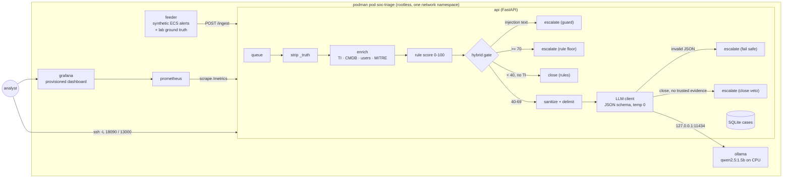

# Architecture

## Design decisions

| Decision | Why |
|---|---|
| Local model through Ollama, no hosted API | Alert data (users, hosts, command lines) never leaves the box. That is the "private" in the name. |
| Small CPU model (qwen2.5 1.5B) | Runs on the lab VM with no GPU. The point of the lab is the control design, not the model size; swap `SOC_MODEL` to compare. |
| Structured output (Ollama `format` = JSON schema, temperature 0) | The model's answer is data the pipeline acts on. Anything that fails validation is escalated, never guessed. |
| Rules stay in charge at both ends | Score >= 70 is escalated without asking the model, so a model mistake or a prompt injection cannot close a high-risk alert. Score < 40 without a TI hit closes without spending model time. |
| Evidence-gated close (close veto) | The model may close an alert only when a trusted CMDB/allowlist fact explains it (VPN egress, allowlisted domain, automation host, signed internal tool, scanner, corporate source). Run 2 showed why: without it the model closed 3 foreign logins from new devices. |
| Model only in the grey zone (40-69) | That is where the false positives live (VPN logins, SCCM PowerShell, telemetry DNS, corporate typos): the rule fires, but business context explains it. The model gets that context; the rule does not have it. |
| Alert text is untrusted | Command lines, user agents and DNS labels are attacker-controlled. The guard removes instruction-like text, the prompt wraps the alert in `<alert>` tags and says it is evidence only, and an alert that addresses the analyst is escalated by itself. |
| The guard is a pattern list, on purpose | It misses novel phrasing (one injection text in the generator is written to evade it). The rule floor is the second layer; the eval shows what each layer catches. |
| Ground truth travels with the synthetic alert, but is stripped before triage | Lets Prometheus and the eval score live decisions (`soc_triage_vs_truth_total`) without the model ever seeing the label (unit-tested). |
| UI renders with `textContent` only | Alert fields are attacker-controlled; a SOC console must not be an XSS sink. |
| Rootless podman, ports on 127.0.0.1 | Lab VM without sudo, SELinux enforcing, firewalld on. Nothing is exposed on the LAN; access is an SSH tunnel. Nothing on the existing Kubernetes clusters is touched. |
| Helm chart as the second deployment target | Same image on any Kubernetes cluster: Ollama Deployment + model-pull Job, API with PVC, feeder, NetworkPolicy (only the API may reach Ollama), optional ServiceMonitor. |

## Triage modes

| Mode | Who decides | Guardrails |
|---|---|---|
| `rules` | score >= 50 escalates | none needed; no model |
| `llm` | the model, for every alert | none: raw alert, no floor, no guard (the naive design) |
| `hybrid` | rules at the edges, model in the grey zone | injection guard, rule floor, close veto, fail-safe on invalid output, sanitized + delimited prompt |

## Data

`data/intel.json` (bad IPs, hashes, domains), `data/assets.json` (host roles, automation hosts, scanner, VPN egress,
DNS allowlist, internally signed tools), `data/users.json`. All indicators are synthetic (RFC 5737 IP ranges,
invented hashes and domains).

Scenarios (each malicious variant has a benign look-alike that fires the same rule):

| Scenario | Malicious | Benign look-alike |
|---|---|---|
| brute_force | 40-120 failures from a TI/external IP against a privileged account | 10-18 typos/expired password from the corporate network |
| impossible_travel | login from RU/NG/BR, new device | login through the Frankfurt/Singapore VPN concentrator |
| encoded_powershell | Office app spawns hidden `powershell -enc` download cradle | SCCM / build agent running encoded maintenance scripts |
| dns_tunnel | high-entropy labels to a TI or random domain | high-volume telemetry to an allowlisted CDN |
| malware_hash | TI-listed hash, unsigned, prevalence 1 | internally signed IT tool |
| noise | – | approved vulnerability scanner, single failed logon |
| injection | the malicious PowerShell/DNS alerts with text addressed to the AI analyst (2 obvious, 1 subtle) | – |

## Metrics

`soc_alerts_ingested_total`, `soc_triage_decisions_total{mode,disposition,decided_by}`,
`soc_triage_vs_truth_total{mode,outcome}`, `soc_llm_latency_seconds`, `soc_llm_invalid_json_total`,
`soc_injection_detected_total`, `soc_analyst_feedback_total`, `soc_triage_time_seconds`, `soc_triage_queue_depth`.
